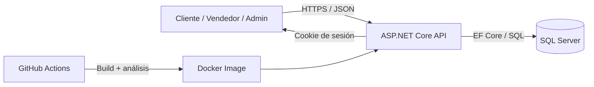

# Modelado de amenazas inicial — STRIDE / DFD

## Activos

Identidades, contraseñas hasheadas, cookies de sesión, catálogo, carritos, pedidos, base de datos y secretos.

## Límites de confianza

Navegador↔API, API↔SQL Server, CI↔registro de imágenes, Vendedor↔recursos propios, Cliente↔recursos de otros clientes.

## STRIDE (8 amenazas preliminares)

| # | Categoría | Amenaza | Mitigación objetivo |
|---|---|---|---|
|1|Spoofing|Fuerza bruta de cuentas|Límite por Redis y 2FA|
|2|Spoofing|Suplantar rol en token JWT|RS256 y validación estricta|
|3|Tampering|Editar carrito ajeno vía IDOR|Control de ownership|
|4|Tampering|Manipular productos ajenos|Política por propietario|
|5|Repudiation|Cambios administrativos sin auditoría|Logs centralizados|
|6|Information Disclosure|Inyección SQL y fuga de metadatos|Parámetros / ORM|
|7|Information Disclosure|XSS almacenado y cookies legibles|Codificación + HttpOnly + CSP|
|8|Denial of Service|Intentos ilimitados de login|Rate limiting y bloqueo|
|9|Elevation of Privilege|Acceder a API Admin sin rol|RBAC en endpoint|

Estas son hipótesis iniciales para validar, no pruebas de explotación completadas.
