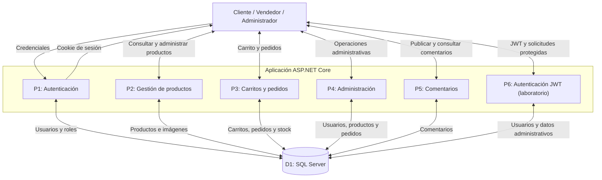

# Modelado de amenazas — Mercado ISW

## 1. Descripción del sistema

Mercado ISW es una miniaplicación web desarrollada en ASP.NET Core 10, Entity Framework Core y SQL Server 2022.

El sistema dispone de tres roles:

- Cliente: consulta productos, administra su carrito y realiza pedidos.
- Vendedor: crea, modifica y elimina sus productos.
- Administrador: administra productos y consulta información general.

La aplicación utiliza autenticación mediante cookies y dispone de un modo de laboratorio (`LAB_MODE`) para realizar pruebas de seguridad.

El proyecto utiliza Git y Docker.

## 2. Activos protegidos

1. Credenciales y contraseñas de los usuarios.
2. Cookies de sesión.
3. Tokens JWT utilizados en el laboratorio.
4. Datos de usuarios y sus roles.
5. Productos e imágenes.
6. Carritos de compras.
7. Pedidos.
8. Información almacenada en SQL Server.
9. Configuración y secretos de la aplicación.

## 3. Diagrama DFD

## 4. Límites de confianza

**LC1 — Navegador / Servidor**

El navegador es un entorno no confiable. Todas las solicitudes HTTP deben validarse en el servidor.

**LC2 — Servidor / Base de datos**

ASP.NET Core se comunica con SQL Server mediante Entity Framework Core. Las consultas deben impedir manipulaciones SQL.

**LC3 — Cliente / Recursos de otros clientes**

Un cliente solamente debería acceder a sus propios carritos y pedidos.

**LC4 — Vendedor / Productos ajenos**

Un vendedor solamente debería modificar sus propios productos.

**LC5 — Usuario normal / Administrador**

Las operaciones administrativas deben exigir el rol correspondiente.

**LC6 — Token JWT / Servidor**

El servidor debe verificar correctamente la firma y los permisos asociados al token.

**LC7 — Entorno normal / Laboratorio**

Las vulnerabilidades intencionales solamente deben estar disponibles en un entorno de laboratorio aislado.

## 5. Puntos de entrada

| Punto de entrada | Endpoint |
|---|---|
| Inicio de sesión | POST /api/login |
| Consulta de productos | GET /api/products |
| Gestión de productos | POST, PUT y DELETE /api/products |
| Carritos | GET, POST y DELETE /api/cart/{userId} |
| Pedidos | POST y GET /api/orders |
| Comentarios | POST /api/reviews |
| Administración | GET /api/admin |
| Autenticación JWT | POST /api/lab/jwt-login |
| Administración JWT | GET /api/lab/jwt-admin |

Los endpoints JWT indicados existen únicamente cuando LAB_MODE está habilitado.

## 6. Análisis STRIDE

| ID | Categoría STRIDE | Amenaza | Activo afectado | Riesgo |
|---|---|---|---|---|
| T01 | Spoofing | Fuerza bruta y enumeración de usuarios | Credenciales | Suplantación de identidad |
| T02 | Spoofing | Falsificación de JWT con algoritmo none o secreto débil | JWT y roles | Suplantación de administrador |
| T03 | Tampering | Modificación de carritos ajenos mediante IDOR/BOLA | Carritos | Alteración de información |
| T04 | Tampering | Modificación no autorizada de productos ajenos | Productos | Alteración del catálogo |
| T05 | Repudiation | Operaciones administrativas sin evidencia de auditoría suficiente | Registros de actividad | Dificultad para atribuir acciones |
| T06 | Information Disclosure | SQL Injection Blind que revela información de SQL Server | Base de datos | Exposición de información |
| T07 | Information Disclosure | XSS almacenado que expone cookies de sesión | Sesiones | Robo de información |
| T08 | Denial of Service | Ausencia de limitación de intentos de autenticación | Servicio de login | Abuso de recursos |
| T09 | Elevation of Privilege | Acceso a endpoints administrativos sin validar correctamente el rol | Funciones administrativas | Acceso privilegiado |

Estas nueve amenazas se identificaron mediante el modelo STRIDE. Su presencia en la matriz no significa que todas hayan sido explotadas.

## 7. Escenarios de pentesting

Para el segundo parcial se evaluarán cinco vulnerabilidades:

1. SQL Injection Blind con extracción del nombre de la base de datos y una tabla.
2. XSS almacenado con exposición de cookie de sesión en laboratorio.
3. IDOR/BOLA con acceso no autorizado a recursos de otros clientes y al endpoint administrativo.
4. Broken Authentication mediante fuerza bruta, ausencia de rate limiting y enumeración de usuarios.
5. JWT inseguro mediante algoritmo none o secreto débil para elevar privilegios.

Las pruebas deben ejecutarse únicamente contra Mercado ISW en un entorno local controlado.

## 8. Alcance

El modelado y las pruebas corresponden a la Fase 1 — Segundo Parcial de Seguridad de Software.

El objetivo es identificar amenazas y demostrar vulnerabilidades mediante pruebas de concepto documentadas con Burp Suite u OWASP ZAP.

Las evidencias de explotación, las puntuaciones CVSS v3.1 y sus resultados se incorporarán después de ejecutar las pruebas.
